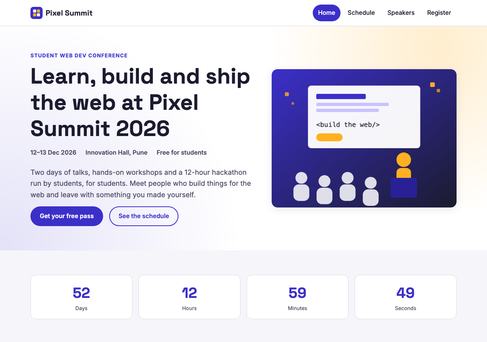
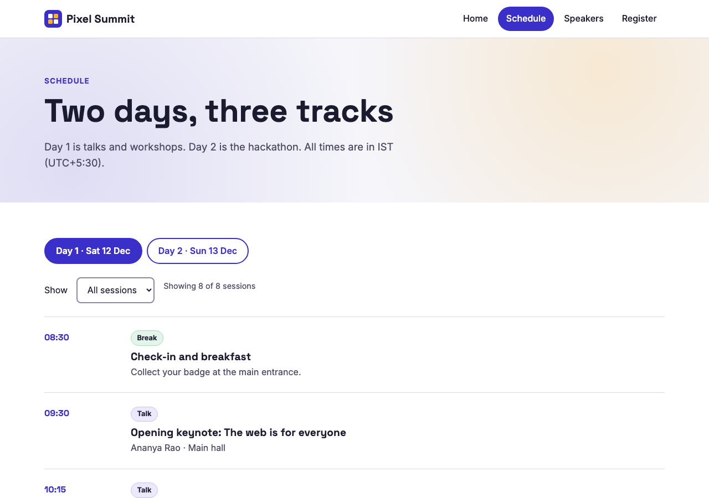
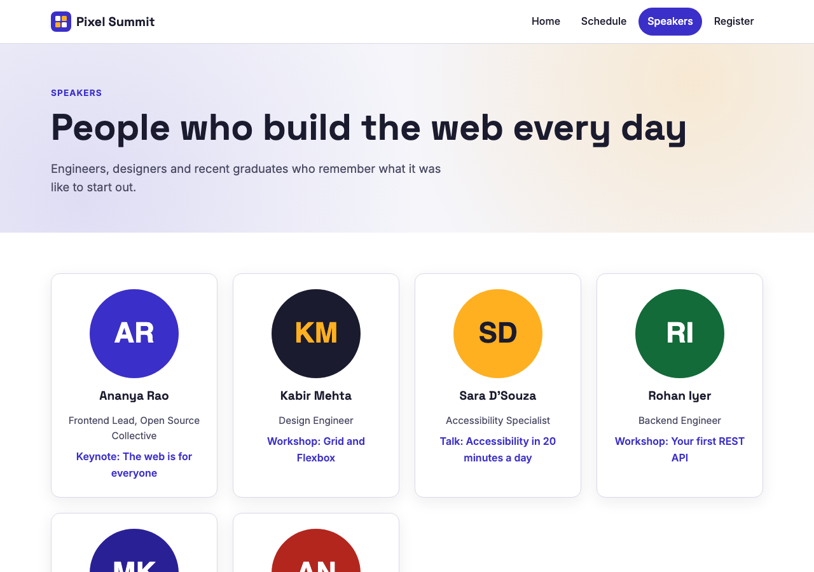
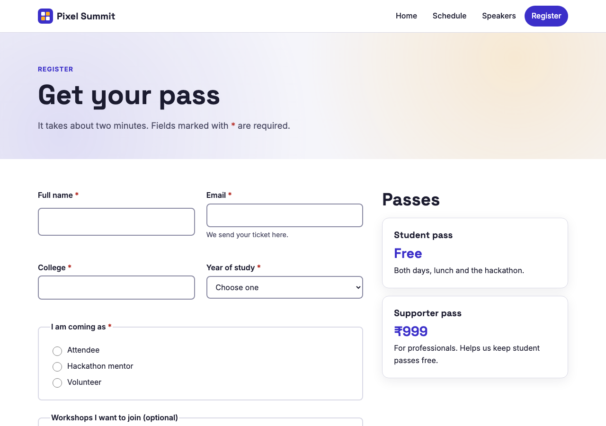
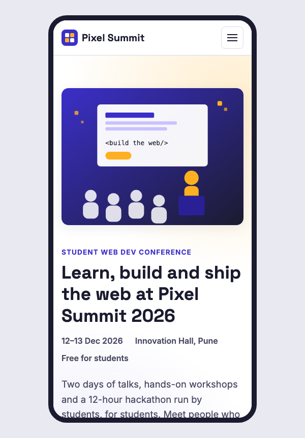

# Pixel Summit 2026 — Multi-page Event Website

A responsive, accessible four-page website for a (fictional) student web development conference.
Built with plain **HTML, CSS and JavaScript**, no frameworks or build step.

> SY Web Dev Recruitment — **Task 1: Responsive multi-page website**

**Live site:** <https://the-creative-developer.github.io/task1-multipage-event-site/> (hosted on GitHub Pages)



## Pages

| Page | What's on it |
| --- | --- |
| `index.html` | Hero, live countdown, why-attend cards, stats, venue, FAQ, call to action |
| `schedule.html` | Two-day timeline with day tabs and a filter by session type |
| `speakers.html` | Speaker cards with avatars and talk topics |
| `register.html` | Registration form with client-side validation |

## Features

- **Same design on every page** — one shared stylesheet (`css/styles.css`) built on CSS custom properties (colours, spacing, radius), plus a shared header, footer and script (`js/main.js`).
- **Responsive** — CSS Grid and Flexbox layouts that collapse to one column on small screens, and a hamburger menu below 860px.
- **Accessibility**
  - Semantic landmarks (`header`, `nav`, `main`, `footer`, `section`, `article`, `aside`)
  - "Skip to main content" link and a visible focus outline on every interactive element
  - Alt text on every meaningful image; decorative images use `alt=""`
  - Every form field has a `<label>`; errors are linked with `aria-describedby`, marked with `aria-invalid`, and focus jumps to the first invalid field
  - Colour pairs checked for WCAG AA contrast (4.5:1 or better for text)
  - Current page marked with `aria-current="page"`; schedule tabs follow the WAI-ARIA tabs pattern (arrow keys, Home/End)
  - The mobile menu closes with <kbd>Esc</kbd> and returns focus to the button
  - Respects `prefers-reduced-motion`
- **Small touches** — live countdown to the event, live "Showing X of Y sessions" message for screen readers, native `<details>` FAQ.

## Screenshots

| Schedule | Speakers |
| --- | --- |
|  |  |

| Register | Mobile |
| --- | --- |
|  |  |

## Run it locally

No install needed.

1. Clone the repo
   ```bash
   git clone https://github.com/The-Creative-Developer/task1-multipage-event-site.git
   cd task1-multipage-event-site
   ```
2. Open `index.html` in a browser, **or** serve the folder (recommended):
   ```bash
   python3 -m http.server 8000
   ```
   then visit <http://localhost:8000>.

## Project structure

```
.
├── index.html
├── schedule.html
├── speakers.html
├── register.html
├── css/
│   └── styles.css      # shared design tokens + all styles
├── js/
│   ├── main.js         # shared: mobile menu, footer year, countdown
│   ├── schedule.js     # day tabs + session filter
│   └── register.js     # form validation
├── assets/             # SVG logo, illustrations and speaker avatars
└── screenshots/
```

## Notes

The event, speakers and contact details are made up for this task. The register form has no backend; a valid submission shows a confirmation message.
